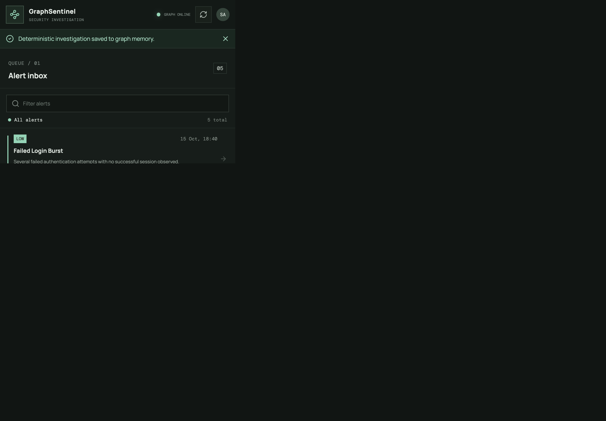

# GraphSentinel

GraphSentinel is a local, synthetic-data security investigation demo. This checkout contains the Phase 1 graph foundation, Phase 2 repository/provenance/dependency analysis and deterministic scoring, Phase 3 FastAPI/investigator backend, Phase 4 persistent episode memory and approval-gated simulated responses, Phase 5 read-only MCP server, and Phase 6 React dashboard.

## Requirements

- Docker Desktop
- Python 3.11 or newer

## Start and seed

```sh
cp .env.example .env
python3 -m venv .venv
source .venv/bin/activate
python -m pip install -r requirements.txt
docker compose up -d
python -m graphsentinel.seed
python -m pytest -q
python -m uvicorn graphsentinel.api:app --reload --host 127.0.0.1 --port 8000
```

FalkorDB uses the pinned `falkordb/falkordb:6.0.2` image. Compose binds its port to localhost and persists database files in the `falkordb-data` named volume. The client is pinned to the official `FalkorDB` Python package 1.7.1. Settings are loaded from `.env` and can also be provided as environment variables.

If port `6379` is already occupied, set `FALKORDB_PORT=6380` in `.env` before starting Compose; the same setting configures the Python client.

The API is available at `http://127.0.0.1:8000`; interactive OpenAPI docs are at `/docs`. Read-only endpoints include `GET /health`, `GET /alerts`, `GET /alerts/{alert_id}`, `GET /graph/nodes/{label}/{node_id}`, `GET /services/{service_id}/impact`, `GET /alerts/{alert_id}/incidents`, and `GET /alerts/{alert_id}/episodes`. Start an investigation with `POST /investigations` and `{"alert_id":"alert-2026-1015-001"}`; retrieve its result with `GET /investigations/{investigation_id}`. Completed structured results and graph links are persisted in FalkorDB and are retrieved by new API/app instances.

LLM investigation is optional. Set `OPENAI_API_KEY` and optionally `OPENAI_BASE_URL` and `LLM_MODEL` in `.env` to enable the OpenAI-compatible Chat Completions tool loop. The model only receives the fixed read-only graph tools; its citations and target entities are validated, and application code owns the risk score. Without a key, or when model output/API calls fail, the API returns a deterministic result with `mode: "fallback"` and a limitation stating it was not LLM-driven.

Investigation episodes are matched by shared alert entities and event types. The response explains each match; shared context does not establish a common attack. Past evidence stays historical and does not inflate a new alert's score.

Response simulation endpoints are `POST /investigations/{investigation_id}/response-actions`, `GET /response-actions/{action_id}`, and `POST /response-actions/{action_id}/{approve|reject|execute|verify}`. The only transitions are `PROPOSED -> APPROVED -> EXECUTED_SIMULATED -> VERIFIED`; rejection is terminal. Execution before explicit approval is rejected. Each action has target-linked evidence, actor/timestamp audit records, optimistic state-version checks, and an independent read-back verification. Only `simulation_state` and `simulation_version` properties are changed in FalkorDB; no real containment or remediation is performed.

The restricted MCP server and client configuration are documented in [docs/mcp.md](docs/mcp.md). Launch it with `./.venv/bin/python -m graphsentinel.mcp_server` after the graph is seeded.

## Frontend

In another terminal, start the UI after the API and FalkorDB are running:

```sh
cd frontend
npm install
npm run dev
```

Open `http://localhost:5173`. The frontend calls the real FastAPI service at `http://127.0.0.1:8000` by default. Set `VITE_API_BASE_URL` in `frontend/.env.local` to change it; configure backend `FRONTEND_ORIGIN` to the exact UI origin if it differs from `http://localhost:5173`.

Frontend tests use Vitest: `cd frontend && npm test`; the production type/build check is `cd frontend && npm run build`. The interactive flow uses the real API and graph data. The browser-run workflow covers alert selection, investigation, graph/evidence inspection, approval, simulated execution, independent verification, and a subsequent investigation with saved memory.

Investigation limits are configurable through `MAX_TOOL_CALLS`, `MAX_TRAVERSAL_DEPTH`, `MAX_RETURNED_RECORDS`, `MAX_INVESTIGATION_SECONDS`, `LLM_TIMEOUT_SECONDS`, `MAX_LLM_OUTPUT_TOKENS`, and `MAX_LLM_OUTPUT_CHARS`; values outside hard caps fail settings validation. CORS permits only the configured localhost `FRONTEND_ORIGIN`.

To intentionally delete and recreate only the `graphsentinel` demo graph, run:

```sh
python -m graphsentinel.seed --reset-demo
```

This command refuses to reset a graph configured under a different name. Do not remove the Docker volume unless you intend to erase all persisted FalkorDB data in it.

## Synthetic data

`data/demo_graph.json` contains fictional people, devices, services, alerts, events, evidence, vulnerabilities, incidents, and response proposals. `expected_paths` records two known scenario paths, including a corroborated higher-risk investigation and a lower-risk alert with contradictory/benign context. Demo vulnerability identifiers are synthetic.

## Tests

From the repository root, run `./.venv/bin/python -m pytest -q` for the backend/graph/API/simulator/MCP suite. From `frontend/`, run `npm test` for the Vitest API-client suite and `npm run build` for strict TypeScript plus the production Vite build. Tests connect to the running local FalkorDB and do not delete graph data. Fake model and official MCP clients test their respective protocols; no live LLM API call is made by the test suite.

Run the measured synthetic evaluation from the repository root with `./.venv/bin/python -m graphsentinel.evaluate --output docs/evaluation-results.json`. It checks expected graph paths, evidence IDs, memory retrieval, risk consistency, unsupported assertions, and simulated response verification, then records actual local latency and call counts. See [evaluation methodology](docs/evaluation-methodology.md).

## Submission Materials

- [macOS setup](docs/setup-macos.md)
- [Architecture diagram](docs/architecture.md)
- [Graph schema](docs/graph-schema.md)
- [Risk scoring](docs/risk-scoring.md)
- [MCP setup](docs/mcp.md)
- [Three-minute demo script](docs/demo-script.md)
- [Evaluation methodology and actual results](docs/evaluation-methodology.md)
- [Known limitations](docs/known-limitations.md)
- [Technical blog draft](docs/technical-blog.md)

## Screenshots



