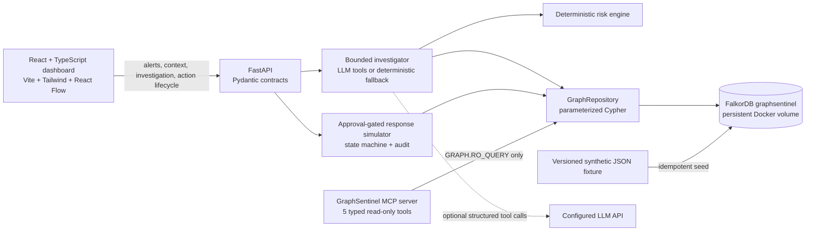

# Architecture

The frontend renders backend-provided records and does not fabricate graph nodes, edges, findings, or action state. The graph repository owns FalkorDB access; only the FastAPI response simulator performs state transitions, and its mutations affect simulation properties only. The MCP server creates a read-only repository and exposes neither Cypher input nor response-action handlers. Investigation episodes and action audit events persist in the named graph.

## Investigation data path

1. The inbox and graph context are loaded from FastAPI read endpoints.
2. Investigation reads bounded alert paths, evidence provenance, incidents, and saved episodes.
3. The deterministic risk engine scores current-alert evidence; historical evidence remains contextual.
4. The response is validated and persisted as an `InvestigationEpisode` with graph links.
5. A human may propose, approve/reject, execute, and verify a simulated response through separate API calls.

## Trust boundaries

- The browser only talks to the configured local FastAPI origin.
- The model can select only predefined, read-only investigation tools.
- Retrieved logs/descriptions are untrusted evidence, not instructions.
- Response proposals do not execute. Execution requires a separate approval request and optimistic target-state check.
- MCP uses `GRAPH.RO_QUERY` and has no route to simulator mutations.
- All graph identities, events, evidence, and services are synthetic demo data.